<div align="center">
  
  
</div>

## Sobre mim

Sou de Lavras, MG, e trabalho remoto para a **Inovcorp**, em Lisboa. No dia a dia eu cuido de tudo um pouco: API, front, banco, pipeline e aquela regra de negócio que ninguém documentou.

Curto arquitetura orientada a eventos, código que o próximo dev consegue ler e deploy que não dá frio na barriga. Uso o **Claude Code** como parceiro de trabalho: ele acelera implementação, refatoração e testes, e eu continuo responsável por revisar e decidir o que vai pra produção.

Estou terminando Sistemas de Informação na UFLA.

<div align="center">
  
</div>

| | |
|---:|:---|
| **600 mil+** | registros num sistema que refatorei com eventos e integrações Azure |
| **65+** | endpoints numa API REST com OAuth 2.0 para operação logística |
| **~1min30s** | de deploy depois de migrar de FTP para SSH (antes eram 5–10 min) |
| **3+ anos** | entregando full stack em produção, sempre remoto |

## Loadout

<div align="center">
  
  <br>
  <sub>Em amarelo, o que eu uso todo dia.</sub>
</div>

## Histórico

```bash
$ git log --graph
```

**`a3f9c1e`** `HEAD -> main` **Inovcorp**, Full Stack Pleno, Lisboa (remoto), 06/2025 até hoje
- Refatorei um sistema com **600 mil+ registros** usando arquitetura orientada a eventos e APIs Azure
- Construí uma **API REST com 65+ endpoints**, OAuth 2.0 e vários bancos para operação logística
- Desenvolvi o CRM interno com chat em tempo real via WebSockets, boards de tarefas e agenda
- Criei um boilerplate com auto-discovery de relações e geração de CRUDs para novos projetos
- Migrei o deploy de FTP para SSH com GitHub Actions: de 5–10 min para **~1min30s**

**`7be20d4`** **Dream On**, Full Stack (remoto), 02/2024 a 04/2024
- Plataforma de venda de ingressos com Next.js, NestJS, Tailwind, Prisma e DynamoDB, aplicando DDD, Clean Architecture e SOLID

**`c41e8a9`** **GAFIT**, Full Stack (remoto), 03/2023 a 04/2025
- Sistema de credenciamento para o **Carnaval do Rio** com Next.js e NestJS, do levantamento de requisitos à entrega
- Marketplace e e-commerce de logística no Reino Unido com Laravel, JavaScript e SCSS
- Front responsivo e suporte técnico na Medicana, plataforma de saúde com cara de marketplace

**`0f12b37`** **UFLA**, Bacharelado em Sistemas de Informação, 2022 a 2026

## Fora do expediente

**Tarkov.** Nas horas vagas sou PMC em Escape from Tarkov. O jogo me ensinou que planejar a extração vale mais que o loot. Serve pra deploy também.

**Jogos em geral.** Do competitivo ao jogo que dá pra largar no meio. É onde eu desligo a cabeça do trabalho e, de vez em quando, tenho a ideia que faltava.

**IA e Claude Code.** Gosto de testar ferramenta nova e entender como a IA muda o jeito de programar. A IA escreve, eu reviso.

## Bora construir alguma coisa?

Projeto, vaga, troca de ideia sobre arquitetura ou squad pra raid. Respondo rápido.

<p>
  <a href="mailto:gabrielxgemente@gmail.com"></a>
  <a href="https://wa.me/5535998142009"></a>
</p>
